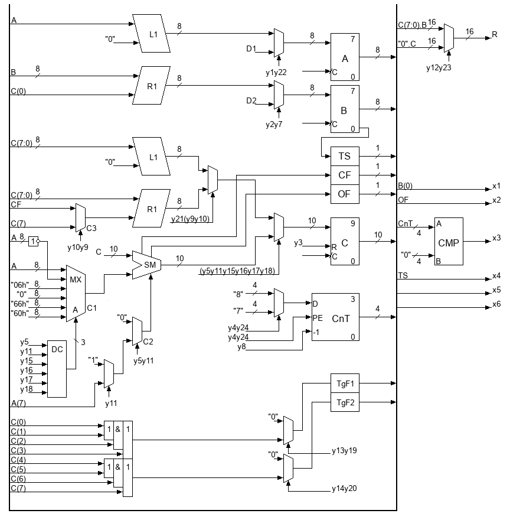
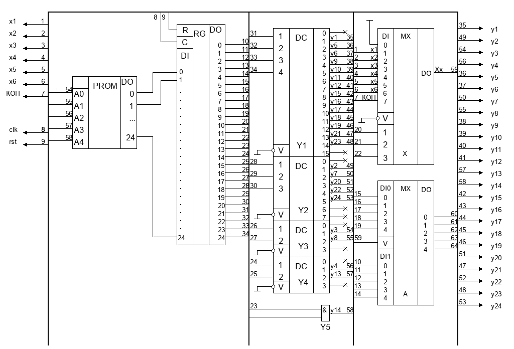

# Custom FSMD Processor Module in VHDL

## Overview
This repository contains an RTL implementation of a custom digital processing module written in VHDL. The module is designed using the FSMD (Finite State Machine with Datapath) paradigm to execute signed integer multiplication and binary-to-BCD conversion.

This design was created as part of a course project for the Computer Circuit Design course at Kharkiv National University of Radio Electronics, Ukraine.

## Architecture
The architecture strictly separates data processing and control logic into different modules:
- Datapath (execution unit): contains the registers, ALU and multiplexing logic. The datapath architecture was manually optimized by finding equivalence classes of micro-operations and sharing hardware resources between them.
- Control unit: Implemented as a Microprogrammed ROM-based FSM with explicit next-state addressing.

## Schematics
Manually drawn RTL schematics can be seen below.

Datapath:

Control unit:

